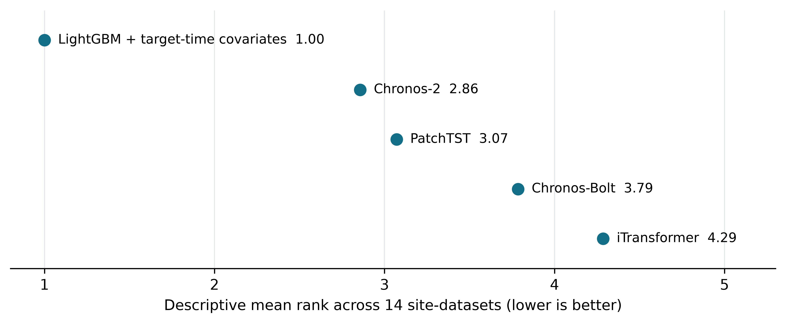
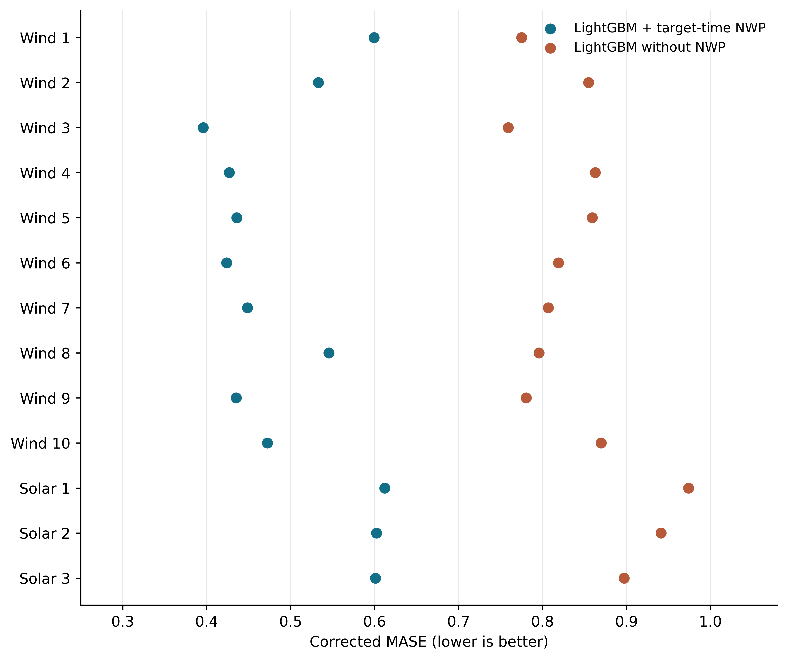

# Supplementary analyses

These results use older hourly-origin or site-level pilot protocols. They provide context only and are not pooled with the main daily comparison. All figures and tables here use the S prefix.

## S1. Retrospective hourly-origin comparison

For context, Table S1 retains the broader archived hourly-origin sweep. Under that retrospective target-time-NWP setting, LightGBM has the lowest observed MASE at all thirteen renewable sites. For five complete-coverage models across fourteen site-datasets (including the load reference), the Friedman statistic is χ² = 35.26 (nominal p = 4.11 × 10⁻⁷). The descriptive mean ranks are LightGBM with target-time covariates 1.00, Chronos-2 2.86, PatchTST 3.07, Chronos-Bolt 3.79, and iTransformer 4.29. A conventional Nemenyi calculation gives a nominal CD of 1.63 (α = 0.05, k = 5), but the independent-block assumption is doubtful for these sites, so this threshold is not used to declare significance. Excluding wind zone 3, where archived eligible origins are not strictly matched, leaves thirteen site-datasets and a Friedman χ² of 32.00 (nominal p = 1.91 × 10⁻⁶). The old hourly test is not a significance test for the new daily paired comparison. Correlated wind zones and the single-source setting prevent population-level inference from either analysis.

**Figure S1.** Descriptive archived hourly-origin mean ranks for the five complete-coverage models under corrected MASE. No critical-difference or significance graphic is shown because sites from the same GEFCom competition are not independent sampling blocks.

**Table S1.** Archived retrospective hourly-origin cross-site mean corrected MASE (lower is better), computed from 397 deduplicated step=1 runs by averaging seeds within each site and then averaging sites. This table is not an issuance-aligned or future-information-matched comparison. Wind and load use all valid hours; solar uses observed power >1%. The denominator is the training-period 24-hour seasonal-naïve error. Wind: ten zones; solar: three sites unless a smaller count is shown; load: one GEFCom reference zone. Per-site scores and coverage are in Appendix A. Wind zone 3 should not be interpreted as a strict common-origin paired comparison.

| Model | Wind (10) | Solar (3) | Load (ref.) |
|---|---|---|---|
| LightGBM + target-time covariates | **0.472** | **0.605** | **0.378** |
| TTM (zero-shot) | 0.815 | 0.953 | — |
| TimesFM-2.0 | 0.836 | 1.002 | — |
| Moirai-2 | 0.823 | 0.887 | — |
| PatchTST (+cov) | 0.854 | 1.186 | 0.960 |
| TimeMixer (+cov) | 0.856 | 1.099 (2 sites) | — |
| DLinear | 0.860 | 0.990 (2 sites) | — |
| Chronos-2 | 0.874 | 0.862 | 0.947 |
| Chronos-Bolt | 0.894 | 0.877 | 0.756 |
| iTransformer (+cov) | 0.912 | 0.988 | 1.420 |

**Table S2.** Post-hoc CPU LightGBM arm without NWP at hourly origins (five seeds per site); the with-covariate and fixed zero-shot comparator scores are from Table S1. The no-NWP LightGBM retains calendar features and is a closer, though not identical, information comparison with target-history TSFMs. This arm is excluded from the archived five-model rank test. Full per-site results are in `experiments/information_match_cpu/report.md`.

| Track | LightGBM without NWP | LightGBM with target-time covariates | Fixed zero-shot comparator |
|---|---:|---:|---:|
| Wind | 0.818 | 0.472 | TTM 0.815 |
| Solar | 0.937 | 0.605 | Chronos-2 0.862 |
| Load | 0.791 | 0.378 | Chronos-Bolt 0.756 |

Within the old hourly-origin LightGBM setting, adding target-time weather covariates reduces corrected cross-site mean MASE by 42.4% on wind and 35.4% on solar. This measures an information-setting difference within one architecture, not an operational gain. Without NWP, LightGBM and TTM are approximately tied on the old wind cross-site mean (the sign changes after excluding wind zone 3); Chronos-2 is below LightGBM without NWP at each old solar site. The load covariates are temperatures rather than renewable NWP. The primary daily-origin comparison addresses the missing future-covariate Chronos-2 arm on common evaluation windows; its scores should not be mixed numerically with this old hourly-origin table.

**Figure S2.** Descriptive per-site scores for the post-hoc LightGBM no-NWP arm and the archived target-time-NWP arm. The dots are unconnected and no per-origin paired uncertainty is estimated. The target-time-NWP arm is retrospective and does not establish an operational gain.

The two protocols should be interpreted separately. First, the archived unequal-information hourly sweep shows a larger model gap than the new daily paired comparison; the two protocols use different origins and should not be interpreted as a pure ablation. Second, on the GEFCom load reference, zero-shot Chronos (0.756) outperforms two deep forecasters trained from scratch (PatchTST 0.960; iTransformer 1.420), while LightGBM with temperature covariates remains best (0.378). Third, giving future NWP to Chronos-2 improves its renewable scores, while LightGBM still has lower observed error at every matched site. The comparison holds future-information availability and scored origins fixed; it does not equalize architecture, site-specific training, or input representation.

In the solar zone-1 pilot, TTM's full fine-tuning and LoRA scores were 0.965 and 0.964 in the original test-denominator metric, respectively. These results should be compared with a zero-shot TTM run evaluated using the same rolling-origin protocol before quantifying the adaptation gain. The near-equal scores show that LoRA was competitive with full fine-tuning in this pilot; they do not identify the binding constraint across TSFMs.

## S2. Probabilistic calibration: mixed outcomes in zone-1 pilots

Table S3 reports zone-1 interval pilots. On wind, CQR increased empirical coverage from 0.738 to 1.000 but widened the interval to 0.952 on the [0, 1] power scale; this is a poor coverage–width trade-off in that pilot. On solar, CQR over-covered (0.987), whereas split conformal on LightGBM under-covered (0.793), so neither result supports a general claim of nominal solar calibration. The native Chronos row has nominal 80% coverage, whereas the conformal rows target 90%. The load width values are reported in MW and require a separate definition from prediction interval normalized average width (PINAW). These observations motivate, but do not validate, the protocol's volatility-tiered (Mondrian) conformal method and ensemble batch prediction intervals (EnbPI) [23] ablation. Full-site results and calibration-window diagnostics are needed before attributing the wind behavior to a particular exchangeability failure.

**Table S3.** Interval calibration pilots at zone 1 (PICP / mean interval width). Native Chronos intervals target 80% coverage; conformal rows target 90%. Load widths are in MW; wind and solar widths use the [0, 1] power scale.

| Wrapper | Solar | Wind | Load (MW) |
|---|---|---|---|
| Chronos native (nominal 80%) | 0.901 / 0.181 | 0.738 / 0.580 | 0.769 / 37.5 |
| CQR on Chronos | 0.987 / 0.371 | 1.000 / 0.952 | 0.998 / 143.3 |
| Split conformal on LightGBM | 0.793 / 0.207 | — | 0.904 / 72.9 |

## S3. Data efficiency: pilot estimates of near-tie points

Restricting LightGBM+NWP training data to the trailing *k* weeks of the training split (validation and test fixed) traces data efficiency in the pilot sites under the original test-denominator metric; these numbers are not directly comparable with corrected Table S1 MASE. On wind, two weeks of site data yields an original scaled score of 0.704 versus 0.706 for the best zero-shot TSFM, a near tie. On solar, one month yields 0.914 versus 0.913 for Chronos on the same original scale, also a near tie rather than a demonstrated crossover. Site-level curves and uncertainty estimates are needed before these values can define deployment thresholds.

## S4. Computational efficiency

The archived efficiency pilot mixes Apple M1 and Intel Xeon CPU host labels; the earlier draft inadvertently combined their latency values. On the complete Intel Xeon-labelled subset, batch-1 neural-model call times range from DLinear 0.107 ms to TimesFM-2.0 639.460 ms, with TTM 2.987 ms, Moirai-2 11.390 ms, Chronos-2 59.930 ms, and Chronos-Bolt 476.690 ms. These are implementation-specific CPU readings on an A100-equipped host, not GPU timings. The LightGBM 1.270 ms entry is an amortized training-time proxy, and the cloud memory column has inconsistent units in an early file. Accordingly, we do not infer a cross-model Pareto frontier from this pilot; the archive and caveats are detailed in `experiments/efficiency_audit.md`.

## S5. Ramp-event tails: zone-1 exploratory results

In the solar ramp pilot, LightGBM+NWP attains F1 = 0.41 versus 0.19 for Chronos; the ramp-to-non-ramp MAE ratio is 4.5 and 2.8, respectively. In the wind pilot, all evaluated methods have F1 ≤ 0.05 for the specified one-hour threshold. Event counts, precision, recall, and a prevalence-matched baseline are needed to interpret these F1 values, and full-site analysis is needed before generalizing across model families.

## S6. Model routing (exploratory): naive volatility routing fails

In the zone-1 pilot using the original metric, a three-tier volatility router selecting among TSFMs and LightGBM per origin did not beat the best single model: without NWP it reaches 0.716 on the original scaled metric for wind against 0.694 for the best single model; with NWP access it degenerates to always selecting LightGBM. We report this as a bounded negative result—recent-volatility state is not a sufficient routing signal; ramp-activity and NWP-informed states remain open questions.

## S7. Exploratory paired uncertainty for the daily comparison

Table S4 gives within-site paired weather-arm gaps and 95% circular moving-block bootstrap intervals. A block contains seven consecutive eligible origins; there are 5,000 resamples with seed 20261106. Solar origins are weighted by scored daylight hours, and LightGBM losses are averaged over five seeds before resampling. The intervals condition on the selected origins and model runs, use no multiple-comparison adjustment, and do not estimate a population of independent sites. Gaps in eligible calendar dates make the seven-origin block an approximation rather than a verified seven-day dependence model. The exact CSV and method are in `experiments/competition_aligned_cpu/paired_site_intervals.csv` and `paired_site_intervals_method.md`.

**Table S4.** LightGBM minus Chronos-2 corrected MASE in the future-NWP arm; negative favors LightGBM.

| Site | Origin days | Gap | Exploratory 95% interval |
|---|---:|---:|---:|
| solar zone 1 | 157 | -0.108 | [-0.154, -0.062] |
| solar zone 2 | 157 | -0.059 | [-0.109, -0.010] |
| solar zone 3 | 157 | -0.061 | [-0.107, -0.019] |
| wind zone 1 | 52 | -0.093 | [-0.173, -0.017] |
| wind zone 10 | 138 | -0.208 | [-0.261, -0.157] |
| wind zone 2 | 86 | -0.107 | [-0.220, +0.037] |
| wind zone 3 | 60 | -0.182 | [-0.255, -0.112] |
| wind zone 4 | 138 | -0.173 | [-0.228, -0.124] |
| wind zone 5 | 138 | -0.229 | [-0.291, -0.166] |
| wind zone 6 | 138 | -0.207 | [-0.266, -0.151] |
| wind zone 7 | 138 | -0.192 | [-0.243, -0.143] |
| wind zone 8 | 138 | -0.119 | [-0.192, -0.039] |
| wind zone 9 | 138 | -0.191 | [-0.253, -0.133] |

## S8. Common-calendar-window sensitivity

This descriptive restriction keeps already-eligible wind origins whose source-file dates fall between 10 October and 20 December 2013, the intersection of the ten zones’ eligible date ranges. Each zone contributes 38–72 origins. It does not restore windows excluded by the common 512-hour raw-context rule or identify their unobserved errors.

**Table S5.** Equal-weight mean site MASE for ten wind zones in the common date range.

| Model | Calendar only | Weather arm |
|---|---:|---:|
| LightGBM | 0.740 | 0.481 |
| Chronos-2 | 0.744 | 0.643 |

## S9. Metric-definition sensitivity on the same daily predictions

The original implementation used a test-period 24-hour seasonal-naïve denominator and an observed-power >1% mask on wind as well as solar. Table S6 reconstructs that definition on exactly the same saved daily predictions and eligible origins as Table 3; it is not an archived hourly score. Each LightGBM seed is scored separately before averaging. Under both definitions, LightGBM has the lower weather-arm MASE at all thirteen sites. In the calendar arms, wind zone 8 alone changes the sign of the within-site model gap (five LightGBM site wins under the original rule versus four after correction). The script `code/experiments/derive_metric_definition_sensitivity_cpu.py` records the exact original denominator call and scoring mask.

**Table S6.** Equal-weight site-mean MASE on the frozen daily predictions under the corrected and reconstructed original metric rules.

| Track | Model | Arm | Corrected | Original rule reconstructed |
|---|---|---|---:|---:|
| wind | LightGBM | calendar | 0.817 | 0.716 |
| wind | LightGBM | weather | 0.477 | 0.412 |
| wind | Chronos-2 | calendar | 0.813 | 0.712 |
| wind | Chronos-2 | weather | 0.648 | 0.578 |
| solar | LightGBM | calendar | 0.798 | 0.800 |
| solar | LightGBM | weather | 0.573 | 0.574 |
| solar | Chronos-2 | calendar | 0.720 | 0.722 |
| solar | Chronos-2 | weather | 0.649 | 0.650 |

## S10. Source-file solar clock audit

The circular centroid is computed from the 24 hourly mean powers in the processed solar series, weighting each hour by its mean normalized power. It describes the source-file cycle, not solar noon or a civil time zone; panel orientation, clouds, clipping and curtailment can shift the power centroid. The source files do not record the local civil clock or individual NWP issue instants.

**Table S7.** Solar production timing in the source-file time coordinate.

| Solar site | Circular power centroid (hour) | Mean power at 00:00 | Active at 00:00 |
|---|---:|---:|---:|
| solar site 1 | 1.95 | 0.534 | 100.0% |
| solar site 2 | 3.04 | 0.405 | 100.0% |
| solar site 3 | 2.05 | 0.563 | 99.4% |

## S11. Post-hoc past-weather-only Chronos-2 arm

The pinned Chronos-2 checkpoint was rerun on the same 1,635 eligible daily origins using CPU. Target history and future calendar are unchanged. Past NWP fields appear only in the historical input; the future input contains calendar but no NWP. The archived full-weather arm contains both historical and future NWP. The contrast is a within-model input ablation, not a matched comparison of training regimes or independently timestamped weather vintages. The run manifest and all thirteen new point-forecast files are retained in `experiments/competition_aligned_cpu/chronos2_past_weather/`.

**Table S8.** Equal-weight site-mean Chronos-2 MASE (lower is better). Future increment is the relative reduction from past-weather-only to past-and-future weather.

| Track | Calendar only | Past weather only | Past + future weather | Future increment |
|---|---:|---:|---:|---:|
| wind | 0.813 | 0.799 | 0.648 | 18.9% |
| solar | 0.720 | 0.708 | 0.649 | 8.4% |

**Table S9.** Per-site Chronos-2 MASE for the fixed-origin input ablation.

| Site | Origin days | Calendar only | Past weather only | Past + future weather |
|---|---:|---:|---:|---:|
| solar zone 1 | 157 | 0.749 | 0.734 | 0.687 |
| solar zone 2 | 157 | 0.695 | 0.688 | 0.634 |
| solar zone 3 | 157 | 0.716 | 0.702 | 0.626 |
| wind zone 1 | 52 | 0.825 | 0.824 | 0.704 |
| wind zone 10 | 138 | 0.836 | 0.833 | 0.682 |
| wind zone 2 | 86 | 0.824 | 0.804 | 0.672 |
| wind zone 3 | 60 | 0.690 | 0.679 | 0.575 |
| wind zone 4 | 138 | 0.833 | 0.802 | 0.598 |
| wind zone 5 | 138 | 0.858 | 0.834 | 0.669 |
| wind zone 6 | 138 | 0.812 | 0.796 | 0.637 |
| wind zone 7 | 138 | 0.831 | 0.823 | 0.642 |
| wind zone 8 | 138 | 0.821 | 0.810 | 0.669 |
| wind zone 9 | 138 | 0.795 | 0.785 | 0.628 |
